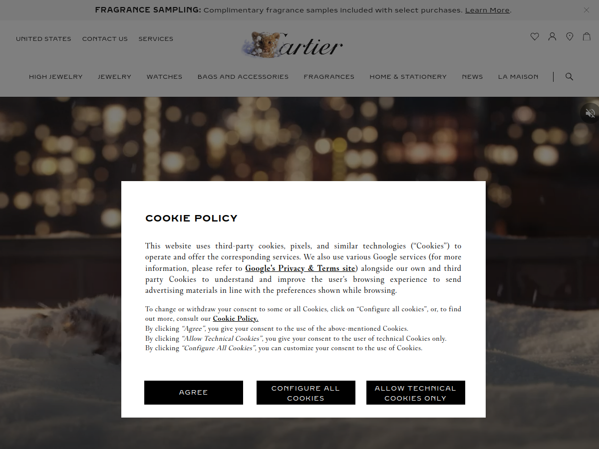
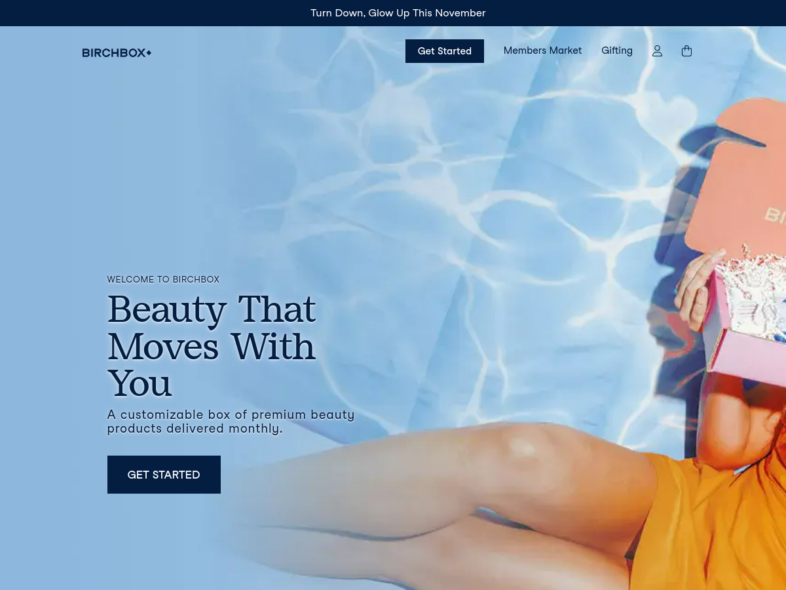

# nextjs-wanderlust-explorer-jsulkoski
Wanderlust Explorer with React and Next.js

## Design References

The explorer's editorial imagery and polished content sections draw inspiration from these references:

### Cartier

[Visit Cartier](https://www.cartier.com/en-us/)

### Birchbox

[Visit Birchbox](https://www.birchbox.com/)
